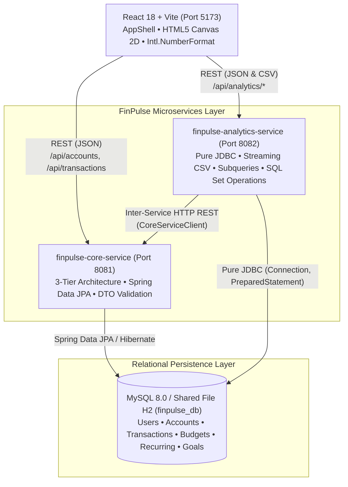

# FinPulse — Personal Financial Management & Analytics Platform

FinPulse is an enterprise-grade personal finance and analytical web application designed with a calm, information-dense fintech user interface (inspired by Stripe and Linear). It features a decoupled dual-microservice backend built on Spring Boot 3 with high-performance pure JDBC analytical querying, dual-mode database support (MySQL 8.0 and embedded H2), and a responsive React frontend powered by custom HTML5 Canvas 2D charting without third-party chart dependencies.

---

## Architecture Diagram



---

## Key Features

1. **Information-Dense Fintech Interface:**
   - Calm, trustworthy styling with WCAG AA compliant contrast in both Light (`#F7F8FA`) and Dark (`#0F1318`) themes.
   - Built purely on CSS variables, Flexbox, and a 12-column CSS Grid.
   - Zero third-party UI or icon libraries; includes a dedicated pure inline SVG icon engine.
2. **Pure HTML5 Canvas 2D Charting Engine:**
   - 100% custom-built charting suite ([LineAreaChart](file:///C:/Users/karth/OneDrive/Desktop/FSWD/FinPulse/finpulse-frontend/src/components/charts/LineAreaChart.jsx), [BarChart](file:///C:/Users/karth/OneDrive/Desktop/FSWD/FinPulse/finpulse-frontend/src/components/charts/BarChart.jsx), [DonutChart](file:///C:/Users/karth/OneDrive/Desktop/FSWD/FinPulse/finpulse-frontend/src/components/charts/DonutChart.jsx)) operating directly on the Canvas 2D context.
   - Dual-layer HiDPI/Retina pixel ratio calibration eliminating blurriness across all display densities.
   - Hover hit-testing, requestAnimationFrame tweening, DOM tooltips, and screen-reader accessibility fallbacks.
3. **Core Financial Ledger & Double-Entry Transfers:**
   - Inter-account fund transfers are executed atomically as paired relational entries (`EXPENSE` and `INCOME`) consolidated into unified ledger records.
   - Real-time balance updates with strict overdraft protection on non-credit accounts (HTTP 409 Conflict guard).
4. **Analytical SQL Set Operations & Subqueries (Pure JDBC):**
   - **Correlated Subquery:** Evaluates spending spikes where current month category expenditure exceeds 120% of the 3-month trailing average.
   - **SQL UNION:** Assembles a 60-day cash flow projection timeline combining actual historical transactions and upcoming recurring commitments.
   - **SQL INTERSECT:** Identifies recurring merchants charged across consecutive months to uncover hidden subscriptions.
   - **SQL EXCEPT:** Pinpoints budgeted categories with zero expenditure to identify free surplus cash.
5. **Budgeting with 3-Month Trailing Suggestions:**
   - Threshold-colored animated progress bars with explicit text status (`On Track`, `Warning`, `Over Limit`).
   - One-click limit suggestions calculated from 3-month trailing averages.
   - 1-click "Copy from Last Month" budget duplication (`POST /api/budgets/copy`).
6. **Recurring Commitments & Savings Goals:**
   - Normalized monthly run-rate calculations with automatic schedule advancement upon payment (`POST /api/recurring/{id}/pay`).
   - Savings goals with monthly required deposit pace and milestone completion celebrations.
7. **Streaming CSV Exporter:**
   - Pure JDBC cursor-based streaming directly to the HTTP response stream with UTF-8 BOM encoding for native Microsoft Excel and Google Sheets compatibility.

---

## Prerequisites

- **Java Development Kit (JDK):** Java 17, 21, or 24 (`java -version`)
- **Apache Maven:** Version 3.8+ or 3.9+ (`mvn -v`)
- **Node.js:** Version 18+, 20+, or 22+ (`node -v`)
- **npm:** Version 9+, 10+, or 11+ (`npm -v`)
- **PowerShell:** Version 5.1 or PowerShell 7 (`pwsh`)
- *(Optional)* **MySQL 8.0:** Running on `localhost:3306` with database `finpulse_db` (defaults to H2 fallback if not running).

---

## Quick Start

### 1. One-Click Launch (Default: Shared File H2 Profile)
No database installation or configuration required. Launches both microservices and the Vite frontend:
```powershell
.\start-all.ps1
```
This script verifies prerequisites, starts both backend services, polls health endpoints until ports 8081 and 8082 are online, boots the Vite frontend on port 5173, and opens your browser automatically.

### 2. Launch with MySQL 8.0 Profile
If you have MySQL 8.0 running locally on port 3306:
```powershell
.\start-all.ps1 -Profile mysql
```

### 3. Graceful Shutdown
To cleanly terminate all three running services:
```powershell
.\stop-all.ps1
```

### 4. Running the Smoke Test Suite
Verifies all 35 REST endpoints across both microservices:
```powershell
.\scripts\smoke-test.ps1
```

---

## Environment Variables

| Variable | Default Value | Description |
|:---|:---|:---|
| `FINPULSE_DB_URL` | `jdbc:h2:file:.../database/finpulsedb;MODE=MySQL;AUTO_SERVER=TRUE` | JDBC connection string |
| `FINPULSE_DB_USER` | `sa` (H2) / `root` (MySQL) | Database user |
| `FINPULSE_DB_PASSWORD` | *(empty)* (H2) / `root123` (MySQL) | Database password |
| `FINPULSE_CORE_URL` | `http://localhost:8081` | Core service base URL for analytics client |

---

## Database Seeding & Schema Reset

The database schema and 6 months of realistic transaction history are defined in:
- `database/schema.sql`: DDL defining tables, constraints, foreign keys, and indexes.
- `database/data.sql`: DML containing 6 months of relative transaction records.

To reset the database manually:
- **H2 Mode:** Delete the `database/finpulsedb.mv.db` file and restart `finpulse-core-service`. The service will automatically recreate tables and seed initial data.
- **MySQL Mode:** Run `mysql -u root -p < database/schema.sql` followed by `mysql -u root -p finpulse_db < database/data.sql`.

---

## REST API Reference

### Core Transactional Service (`http://localhost:8081`)

| Method | Endpoint | Description |
|:---|:---|:---|
| `GET` | `/api/users/{id}` | Retrieve user profile metadata |
| `PUT` | `/api/users/{id}` | Update name, email, display currency, and locale |
| `GET` | `/api/accounts?userId={id}` | List all user accounts (excludes archived by default) |
| `POST` | `/api/accounts` | Create a new financial account |
| `PUT` | `/api/accounts/{id}` | Update account metadata |
| `DELETE` | `/api/accounts/{id}` | Safely archives account if transactions exist, else deletes |
| `GET` | `/api/accounts/summary?userId={id}` | High-level account balances summary |
| `GET` | `/api/accounts/net-worth?userId={id}` | Real-time net worth calculation |
| `GET` | `/api/transactions?userId={id}&from=&to=&accountId=&type=&category=` | Query filtered transactions |
| `POST` | `/api/transactions` | Record transaction with overdraft protection |
| `PUT` | `/api/transactions/{id}` | Update transaction details |
| `DELETE` | `/api/transactions/{id}` | Remove transaction and restore account balance |
| `POST` | `/api/transfers` | Atomic double-entry inter-account transfer |
| `GET` | `/api/budgets?userId={id}&month={YYYY-MM}` | Retrieve monthly budget limits and utilization |
| `POST` | `/api/budgets` | Create or update budget category limit |
| `POST` | `/api/budgets/copy?userId={id}&fromMonth=&toMonth=` | Duplicate prior month budget limits |
| `DELETE` | `/api/budgets/{id}` | Delete budget limit |
| `GET` | `/api/recurring?userId={id}` | List scheduled recurring commitments |
| `POST` | `/api/recurring` | Schedule new recurring payment |
| `PATCH` | `/api/recurring/{id}/active` | Toggle active/paused status |
| `POST` | `/api/recurring/{id}/pay` | Advance schedule and create ledger expense |
| `DELETE` | `/api/recurring/{id}` | Remove recurring commitment |
| `GET` | `/api/goals?userId={id}` | List savings goals with required monthly pace |
| `POST` | `/api/goals` | Create a new savings goal |
| `POST` | `/api/goals/{id}/contribute` | Deposit allocation toward a savings goal |
| `DELETE` | `/api/goals/{id}` | Remove savings goal |
| `GET` | `/api/categories` | List standardized expenditure categories |
| `GET` | `/api/summary/overview?userId={id}` | Aggregated overview metrics |

### Analytics Service (`http://localhost:8082`)

| Method | Endpoint | Description |
|:---|:---|:---|
| `GET` | `/api/analytics/health` | Connectivity check via plain java.sql.Statement |
| `GET` | `/api/analytics/cashflow?userId={id}&months={n}` | Monthly income, expense, and net variance |
| `GET` | `/api/analytics/category-breakdown?userId={id}&month={YYYY-MM}` | Category expenditure shares via multi-table JOIN |
| `GET` | `/api/analytics/spending-spikes?userId={id}&month={YYYY-MM}` | Correlated subquery identifying >120% spikes |
| `GET` | `/api/analytics/timeline?userId={id}&days={n}` | Unified SQL UNION timeline (Actual + Scheduled) |
| `GET` | `/api/analytics/recurring-merchants?userId={id}&month={YYYY-MM}` | SQL INTERSECT recurring merchant audit |
| `GET` | `/api/analytics/unused-budgets?userId={id}&month={YYYY-MM}` | SQL EXCEPT zero-burn budget health |
| `GET` | `/api/analytics/account-balances?userId={id}` | Breakdown of account totals |
| `GET` | `/api/analytics/overview?userId={id}&month={YYYY-MM}` | Unified analytical summary payload |
| `GET` | `/api/analytics/export/transactions.csv?userId={id}&from=&to=` | Pure JDBC streaming CSV export with Excel BOM |

---

## Project Structure

```
FinPulse/
├── database/
│   ├── schema.sql             # Relational DDL for MySQL and H2
│   └── data.sql               # Seed data with 6-month transaction history
├── docs/
│   ├── DECISIONS.md           # Architecture & design decisions log
│   ├── QA_CHECKLIST.md        # Step-by-step browser click-through guide
│   ├── REFACTOR_PLAN.md       # Audit inventory and refactor execution plan
│   └── SYLLABUS_MAPPING.md    # Formal course syllabus compliance mapping
├── finpulse-core-service/      # Spring Boot 3 Core Transaction Service (Port 8081)
│   ├── pom.xml
│   └── src/
│       ├── main/java/com/finpulse/core/
│       │   ├── controller/    # REST Presentation Layer (@RestController)
│       │   ├── service/       # Business Logic Layer (@Service, @Transactional)
│       │   ├── repository/    # Data Access Layer (Spring Data JPA)
│       │   ├── model/         # JPA Domain Entities (@Entity)
│       │   ├── dto/           # Immutable Record DTOs with @Valid
│       │   └── exception/     # @RestControllerAdvice Global Exception Handler
│       └── test/java/com/finpulse/core/ # JUnit 5 & MockMvc Test Suite (29 tests)
├── finpulse-analytics-service/ # Spring Boot 3 Analytics Service (Port 8082)
│   ├── pom.xml
│   └── src/
│       ├── main/java/com/finpulse/analytics/
│       │   ├── controller/    # REST Controllers
│       │   ├── service/       # Analytical Service Layer
│       │   ├── jdbc/          # Pure JDBC Repository & SqlQueryCatalog
│       │   ├── client/        # Inter-Service REST Client (CoreServiceClient)
│       │   └── dto/           # Analytics DTO Records
│       └── test/java/com/finpulse/analytics/ # Pure JDBC Test Suite (20 tests)
├── finpulse-frontend/          # React 18 + Vite Frontend Application (Port 5173)
│   ├── package.json
│   ├── vite.config.js
│   └── src/
│       ├── api/               # Typed Fetch Clients with AbortController
│       ├── components/
│       │   ├── charts/        # Pure HTML5 Canvas 2D Charting Engine
│       │   ├── layout/        # AppShell, Sidebar, Topbar, BottomNav
│       │   ├── transactions/  # Transaction & Transfer Modals
│       │   └── ui/            # Design Token Component Library
│       ├── context/           # Auth, Currency, Theme, Toast Contexts
│       ├── hooks/             # Custom Hooks (useCanvas, useFinancialAnalytics)
│       ├── pages/             # 8 Core Domain Views + NotFound + ErrorBoundary
│       └── styles/            # tokens.css, base.css, layout.css, components.css
├── scripts/
│   ├── smoke-test.ps1         # End-to-end REST API automated test suite
│   ├── start-all.ps1          # Service launch wrapper
│   └── stop-all.ps1           # Clean port cleanup script
├── start-all.ps1               # Root one-click launch script
└── stop-all.ps1                # Root clean shutdown script
```

---

## Running Automated Tests

### 1. Core Service Tests (Spring Data JPA & Business Rules)
```powershell
cd finpulse-core-service
mvn test
```
*Executes 29 JUnit 5 unit and MockMvc integration tests verifying account balance updates, overdraft conflict rules, atomic transfers, recurring date advances, and savings goal amortization.*

### 2. Analytics Service Tests (Pure JDBC & SQL Queries)
```powershell
cd finpulse-analytics-service
mvn test
```
*Executes 20 tests verifying pure JDBC `Connection`, `PreparedStatement`, plain `Statement` health check, SQL set operations (`UNION`, `INTERSECT`, `EXCEPT`), correlated subqueries, and CSV injection sanitization.*

### 3. Frontend Production Build
```powershell
cd finpulse-frontend
npm run build
```
*Validates React JSX compilation, code splitting (`React.lazy` + `Suspense`), CSS token scoping, and builds production bundles in `dist/` with 0 warnings.*

---

## Troubleshooting

- **Port in Use (8081, 8082, or 5173):** Run `.\stop-all.ps1` to terminate lingering processes.
- **Database Lock on H2:** If H2 reports a file lock, ensure no dangling Java processes are running by executing `.\stop-all.ps1`.
- **CORS Issues:** Both services permit `http://localhost:5173` and `http://localhost:3000` out of the box via profile configuration.
- **Encoding in Excel:** The CSV export stream includes a UTF-8 Byte Order Mark (BOM) to ensure non-ASCII currency symbols render properly in Microsoft Excel.
