# 02. Features & User Stories — FinPulse

## A. Implemented Features Grouped by Module

### 1. Core Service (`finpulse-core-service`)
- **Multi-Type Account Management:** Creates, updates, archives, and deletes checking, savings, credit card, cash, investment, and loan accounts. Enforces negative balance conventions for liabilities (credit cards, loans).
  - *Files:* `com.finpulse.core.model.Account`, `com.finpulse.core.service.AccountService`, `com.finpulse.core.controller.AccountController`, `com.finpulse.core.repository.AccountRepository`
- **Transactional Ledger with Filtering:** Records income and expense transactions with date, merchant, category, and account association. Excludes transfers and opening balances from income/expense queries.
  - *Files:* `com.finpulse.core.model.Transaction`, `com.finpulse.core.service.TransactionService`, `com.finpulse.core.controller.TransactionController`, `com.finpulse.core.repository.TransactionRepository`
- **Atomic Double-Entry Transfers:** Executes inter-account fund transfers by creating paired debit (EXPENSE) and credit (INCOME) records with a shared UUID `transfer_group_id` inside an isolated `@Transactional` boundary with overdraft guards.
  - *Files:* `com.finpulse.core.service.TransferService`, `com.finpulse.core.controller.TransferController`, `com.finpulse.core.dto.TransferRequest`
- **Category Monthly Budget Tracking:** Configures monthly spending ceilings per category (`UNIQUE (user_id, category, month_year)`), computes real-time spend against limit, and determines percentage utilization.
  - *Files:* `com.finpulse.core.model.Budget`, `com.finpulse.core.service.BudgetService`, `com.finpulse.core.controller.BudgetController`, `com.finpulse.core.repository.BudgetRepository`
- **Budget Copy/Rollover:** Copies all active budget limits from a prior calendar month to the current month in a single operation.
  - *Files:* `com.finpulse.core.service.BudgetService`, `com.finpulse.core.controller.BudgetController`
- **Recurring Payment Scheduler & Settlement:** Tracks repeating commitments (weekly, monthly, yearly), determines due dates, advances billing cycles upon payment, and automatically logs settlement transactions.
  - *Files:* `com.finpulse.core.model.RecurringPayment`, `com.finpulse.core.service.RecurringPaymentService`, `com.finpulse.core.controller.RecurringPaymentController`, `com.finpulse.core.repository.RecurringPaymentRepository`
- **Savings Goals & Amortization Calculator:** Tracks progress toward savings milestones, calculating completion percentage and required monthly savings contributions based on target date.
  - *Files:* `com.finpulse.core.model.SavingsGoal`, `com.finpulse.core.service.SavingsGoalService`, `com.finpulse.core.controller.SavingsGoalController`, `com.finpulse.core.repository.SavingsGoalRepository`
- **User Scoping & Currency Localization:** Manages user identity, default currency (INR, USD, EUR, GBP), and locale preferences (`en-IN`, `en-US`, `de-DE`).
  - *Files:* `com.finpulse.core.model.User`, `com.finpulse.core.service.UserService`, `com.finpulse.core.controller.UserController`, `com.finpulse.core.repository.UserRepository`
- **Global Error Handling & Validation:** Centralized advice catching validation and business errors, emitting consistent JSON schemas.
  - *Files:* `com.finpulse.core.exception.GlobalExceptionHandler`, `com.finpulse.core.dto.ErrorResponse`

### 2. Analytics Service (`finpulse-analytics-service`)
- **Pure JDBC Execution Engine:** Executes analytical SQL via HikariCP and pure `java.sql.*` connections without JPA/Hibernate overhead.
  - *Files:* `com.finpulse.analytics.jdbc.JdbcReportRepository`, `com.finpulse.analytics.service.AnalyticsService`, `com.finpulse.analytics.controller.AnalyticsController`
- **Monthly Cashflow Aggregation:** Aggregates income, expenses, and net cashflow across the last N calendar months using SQL `GROUP BY`.
  - *Files:* `com.finpulse.analytics.jdbc.SqlQueryCatalog` (`CASHFLOW_QUERY`)
- **Category Spending Breakdown:** Joins transactions, accounts, and users to calculate categorical expense totals and relative percentage shares.
  - *Files:* `com.finpulse.analytics.jdbc.SqlQueryCatalog` (`CATEGORY_BREAKDOWN_QUERY`)
- **Spending Spike Detection (Subquery):** Identifies categories where current month spend exceeds 120% of the rolling average over the prior 3 months.
  - *Files:* `com.finpulse.analytics.jdbc.SqlQueryCatalog` (`SPENDING_SPIKES_QUERY`)
- **Cashflow Timeline Projection (SQL UNION):** Combines historical actual transactions with upcoming scheduled recurring commitments into a single chronological stream.
  - *Files:* `com.finpulse.analytics.jdbc.SqlQueryCatalog` (`TIMELINE_UNION_QUERY`)
- **Recurring Merchant Discovery (SQL INTERSECT):** Discovers common merchants billed in both current and previous calendar months to identify subscriptions.
  - *Files:* `com.finpulse.analytics.jdbc.SqlQueryCatalog` (`RECURRING_MERCHANTS_INTERSECT_QUERY`)
- **Unused Budget Optimization (SQL EXCEPT):** Subtracts active spend categories from budgeted categories to identify zero-expense budgets.
  - *Files:* `com.finpulse.analytics.jdbc.SqlQueryCatalog` (`UNUSED_BUDGETS_EXCEPT_QUERY`)
- **Streaming CSV Export with Security Guards:** Streams transactions directly to the client via `ResultSet` cursor, escaping CSV formulas (`=`, `+`, `-`, `@`) with tab characters to prevent spreadsheet code execution.
  - *Files:* `com.finpulse.analytics.jdbc.JdbcReportRepository` (`streamTransactionsCsv`), `com.finpulse.analytics.controller.AnalyticsController`
- **Executive Microservice Dashboard:** Aggregates analytics queries with account balances fetched via `RestTemplate` from Core Service.
  - *Files:* `com.finpulse.analytics.client.CoreServiceClient`, `com.finpulse.analytics.service.AnalyticsService`

### 3. Frontend Service (`finpulse-frontend`)
- **Dual Theme Engine (Light/Dark/System):** Instant CSS custom-property switching adhering to system preferences with zero page reload.
  - *Files:* `src/context/ThemeContext.jsx`, `src/styles/tokens.css`
- **Native Currency & Locale Formatting:** Formats currency using browser `Intl.NumberFormat` without static conversion rates.
  - *Files:* `src/context/CurrencyContext.jsx`
- **Pure Canvas 2D Charting Engine:** High-performance responsive charts (Donut, Bar, Spline Line) supporting HiDPI displays, hit-testing tooltips, and accessibility tables.
  - *Files:* `src/components/charts/CanvasChart.jsx`, `src/components/charts/LineAreaChart.jsx`, `src/components/charts/BarChart.jsx`, `src/components/charts/DonutChart.jsx`, `src/components/charts/useCanvas.js`
- **Responsive 12-Column Layout:** Mobile-friendly drawer navigation, desktop collapsible sidebar, and adaptive CSS Grid.
  - *Files:* `src/components/layout/AppShell.jsx`, `src/components/layout/Sidebar.jsx`, `src/styles/layout.css`
- **Client Route-Level Code Splitting:** Lazy loading of all 8 route components with React Suspense and Error Boundaries.
  - *Files:* `src/App.jsx`, `src/components/ui/ErrorBoundary.jsx`

---

## B. Product Backlog User Stories (12 Implemented Stories)

### [US1] Multi-Account Ledger & Net Worth Tracking
- **User Story:** As a salaried user, I want to manage multiple financial accounts (checking, savings, credit card, cash, investment, loan) so that I can monitor my complete net worth in one unified ledger.
- **MoSCoW Priority:** Must Have
- **Functional Notes:** Supports positive assets and negative liabilities; net worth = sum of non-archived account balances.
- **Non-Functional Notes:** Zero floating point truncation errors; balances stored as `DECIMAL(15, 2)`.
- **Acceptance Criteria:**
  1. Adding an account updates net worth immediately.
  2. Archiving an account hides it from the default view and excludes it from net worth calculations.
  3. Deleting an account with transaction history prompts an archive confirmation rather than causing database constraint failure.
- **Implementing Files:** `Account.java`, `AccountService.java`, `AccountController.java`, `Accounts.jsx`

### [US2] Transaction Logging & Category Tagging
- **User Story:** As an individual spender, I want to log my daily income and expense transactions with category and merchant details so that I can keep an audit trail of my cash outflow.
- **MoSCoW Priority:** Must Have
- **Functional Notes:** Enforces positive amounts; sign derived from `transaction_type` (`INCOME`/`EXPENSE`).
- **Non-Functional Notes:** Sub-100ms response time on pagination and search; debounced input handling.
- **Acceptance Criteria:**
  1. Expense transactions deduct balance from the associated account; income transactions add to the balance.
  2. Filtering by category, search text, or date range updates the ledger table in real time.
  3. Editing a transaction adjusts the account balance by the exact delta between old and new amounts.
- **Implementing Files:** `Transaction.java`, `TransactionService.java`, `TransactionController.java`, `Transactions.jsx`

### [US3] Atomic Inter-Account Fund Transfers
- **User Story:** As an account owner, I want to transfer money between my accounts (e.g., checking to savings) so that my balances stay synchronized without double-counting income or expenses.
- **MoSCoW Priority:** Must Have
- **Functional Notes:** Creates two linked transaction records with `is_transfer = TRUE` and a common `transfer_group_id`.
- **Non-Functional Notes:** ACID atomicity via Spring `@Transactional`; rollback on source account failure.
- **Acceptance Criteria:**
  1. Source account is debited and destination account is credited within a single database transaction.
  2. If the source checking account has insufficient funds, the transaction is rejected with HTTP 400.
  3. Transfers are completely excluded from income/expense calculations and category breakdown reports.
- **Implementing Files:** `TransferService.java`, `TransferController.java`, `TransferModal.jsx`

### [US4] Category Monthly Budgeting & Risk Alerts
- **User Story:** As a budget-conscious user, I want to define monthly spending limits per category so that I receive visual warnings when my spending approaches or exceeds my threshold.
- **MoSCoW Priority:** Must Have
- **Functional Notes:** Budgets are unique per `(user_id, category, month_year)`. Statuses: OK (<80%), WARNING (80-100%), OVER (>100%).
- **Non-Functional Notes:** Smooth CSS transition animation on progress bar width; WCAG AA accessible text status.
- **Acceptance Criteria:**
  1. Spending in an active category increments the progress bar in real time.
  2. Crossing 80% marks the budget as WARNING (amber); crossing 100% marks it as OVER (red).
  3. Users can copy prior month budgets to the current month in one click.
- **Implementing Files:** `Budget.java`, `BudgetService.java`, `BudgetController.java`, `Budgets.jsx`

### [US5] Recurring Subscription & Bill Scheduler
- **User Story:** As a subscriber to services, I want to register recurring bills with renewal frequencies so that I can anticipate upcoming expenses and mark them paid in one click.
- **MoSCoW Priority:** Should Have
- **Functional Notes:** Supports WEEKLY, MONTHLY, and YEARLY frequencies; calculates days until due.
- **Non-Functional Notes:** Automated calculation of next due date using `java.time.LocalDate`.
- **Acceptance Criteria:**
  1. Recurring bills show due badges ("Due today", "In 3 days", "Overdue").
  2. Clicking "Mark Paid" automatically logs an expense transaction and advances the `next_due_date` by the billing period.
  3. Pausing a recurring payment retains its history but disables billing notifications.
- **Implementing Files:** `RecurringPayment.java`, `RecurringPaymentService.java`, `RecurringPaymentController.java`, `Recurring.jsx`

### [US6] Savings Goals & Target Amortization
- **User Story:** As a saver, I want to define savings goals with target amounts and dates so that I know exactly how much to deposit monthly to achieve my target.
- **MoSCoW Priority:** Should Have
- **Functional Notes:** Calculates completion percentage and `requiredMonthly = (target - saved) / remainingMonths`.
- **Non-Functional Notes:** Automatic handling of goals without target dates (percentage only).
- **Acceptance Criteria:**
  1. Progress updates immediately upon logging goal deposits.
  2. Achieving 100% displays a completion badge and stops monthly payment demands.
  3. Past-due incomplete goals clearly indicate overdue status without application crashing.
- **Implementing Files:** `SavingsGoal.java`, `SavingsGoalService.java`, `SavingsGoalController.java`, `Goals.jsx`

### [US7] High-Performance Pure JDBC Cash Flow Aggregator
- **User Story:** As a data-driven user, I want to view my monthly income vs expenses over a 6-month window so that I can evaluate my net savings trajectory.
- **MoSCoW Priority:** Must Have
- **Functional Notes:** Pure JDBC execution with `java.sql.PreparedStatement` and SQL `GROUP BY`.
- **Non-Functional Notes:** Sub-50ms query execution on 1,000+ transaction rows.
- **Acceptance Criteria:**
  1. Accurately groups historical income and expense transactions by calendar month.
  2. Net cash flow (`income - expenses`) matches manual ledger audits.
  3. Zero reliance on JPA or ORM entities in the analytics microservice.
- **Implementing Files:** `JdbcReportRepository.java`, `AnalyticsService.java`, `SqlQueryCatalog.java`, `Reports.jsx`

### [US8] Anomaly Detection: Spending Spikes
- **User Story:** As a consumer, I want the system to alert me when any category's spending spikes significantly above normal so that I can catch lifestyle creep or unauthorized charges.
- **MoSCoW Priority:** Should Have
- **Functional Notes:** Correlated subquery checks if current spend > 120% of previous 3-month rolling average.
- **Non-Functional Notes:** Filters out categories with zero historical baseline to avoid divide-by-zero errors.
- **Acceptance Criteria:**
  1. Returns categories exceeding 120% along with historical baseline and percentage surge.
  2. Provides deep-link anchors from Dashboard insight pills directly to Reports.
  3. Handles users with fewer than 3 months of history gracefully without throwing SQL errors.
- **Implementing Files:** `JdbcReportRepository.java`, `SqlQueryCatalog.java`, `AnalyticsController.java`, `Reports.jsx`

### [US9] Relational Set Operations: Vendor & Budget Optimization
- **User Story:** As a personal finance auditor, I want to identify repeat subscription vendors via SQL `INTERSECT` and unused budgets via SQL `EXCEPT` so that I can cancel unused services and reclaim unspent capital.
- **MoSCoW Priority:** Should Have
- **Functional Notes:** Uses ANSI SQL `INTERSECT` and `EXCEPT` clauses executed via pure JDBC.
- **Non-Functional Notes:** Compatible with both MySQL 8.0 and H2 (MySQL Mode).
- **Acceptance Criteria:**
  1. `INTERSECT` returns vendors charged in both the current and previous calendar months.
  2. `EXCEPT` isolates budgeted categories that recorded zero expense transactions in the active month.
  3. SQL execution utilizes parameterized inputs to prevent SQL injection.
- **Implementing Files:** `JdbcReportRepository.java`, `SqlQueryCatalog.java`, `AnalyticsController.java`, `Reports.jsx`

### [US10] Unified Cash Flow Timeline (SQL UNION)
- **User Story:** As a cash flow planner, I want a single chronological timeline combining past transactions and future scheduled bills so that I can predict liquidity over the next 30 days.
- **MoSCoW Priority:** Could Have
- **Functional Notes:** SQL `UNION` combines historical actual records (`status = 'ACTUAL'`) and scheduled bills (`status = 'SCHEDULED'`).
- **Non-Functional Notes:** Timeline sorted in strict ascending chronological order.
- **Acceptance Criteria:**
  1. Displays previous 30 days of actual transactions alongside next 30 days of upcoming commitments.
  2. Visual badges distinguish actual debits from projected future bills.
  3. Interactive toggle allows filtering by "All", "Actual only", or "Scheduled only".
- **Implementing Files:** `JdbcReportRepository.java`, `SqlQueryCatalog.java`, `AnalyticsController.java`, `Reports.jsx`

### [US11] Secure Unbuffered CSV Transaction Export
- **User Story:** As a tax preparer, I want to export my transaction records to a CSV file so that I can analyze them in spreadsheet software.
- **MoSCoW Priority:** Could Have
- **Functional Notes:** Direct streaming from JDBC `ResultSet` to HTTP response without memory buffering.
- **Non-Functional Notes:** CSV formula injection protection prepending `\t` to formula triggers (`=`, `@`, `+`, `-`).
- **Acceptance Criteria:**
  1. Triggering export downloads a valid RFC 4180 CSV file with proper headers.
  2. Malicious merchant names like `=cmd|' /C calc'!A0` are sanitized with tab prefixing.
  3. Supports custom date-range presets (Current Month, Last 30 Days, Year-to-Date, All Time).
- **Implementing Files:** `JdbcReportRepository.java`, `AnalyticsController.java`, `ExportModal.jsx`

### [US12] Native Canvas 2D Data Visualizer & Accessibility
- **User Story:** As an end user, I want smooth, interactive 2D charts (donut, bar, spline area) rendered cleanly on high-DPI displays so that I can visualize financial trends without third-party bloat.
- **MoSCoW Priority:** Must Have
- **Functional Notes:** Pure HTML5 Canvas 2D API (`ctx.arc`, `ctx.bezierCurveTo`, `ctx.fillRect`).
- **Non-Functional Notes:** Device pixel ratio scaling (`window.devicePixelRatio`); ResizeObserver auto-resize; hidden accessible data table fallback (`role="img"`).
- **Acceptance Criteria:**
  1. Hovering over chart sectors or bars displays positioned HTML tooltips with formatted currency.
  2. Chart renders crisply on Retina/HiDPI screens without pixelation.
  3. Screen readers receive full data accessibility via hidden semantic HTML tables.
- **Implementing Files:** `CanvasChart.jsx`, `LineAreaChart.jsx`, `BarChart.jsx`, `DonutChart.jsx`, `useCanvas.js`

---

## C. Sprint Grouping (3 Logical Sprints)

*(Sprint grouping is **INFERRED** based on architectural dependency layers and code evolution; verified against file creation timestamps on 2026-11-02 and refactoring milestones on 2026-11-12)*

```mermaid
flowchart LR
    subgraph Sprint1["Sprint 1: Core Relational Ledger & Domain"]
        direction TB
        S1A["US1: Multi-Account Management"]
        S1B["US2: Transaction Logging"]
        S1C["US3: Atomic Transfers"]
        S1D["US4: Category Budgeting"]
    end

    subgraph Sprint2["Sprint 2: Pure JDBC Analytics & SQL Insights"]
        direction TB
        S2A["US7: 6-Month Cash Flow"]
        S2B["US8: Spending Spike Subquery"]
        S2C["US9: INTERSECT & EXCEPT Queries"]
        S2D["US10: Timeline UNION"]
    end

    subgraph Sprint3["Sprint 3: Responsive UI & Canvas 2D Engine"]
        direction TB
        S3A["US5: Recurring Subscriptions"]
        S3B["US6: Savings Goals Amortization"]
        S3C["US11: Secure CSV Stream Export"]
        S3D["US12: Native Canvas 2D Visualizer"]
    end

    Sprint1 --> Sprint2 --> Sprint3
```

### Sprint 1: Core Relational Ledger, Account Balances & Atomic Transfers
- **Sprint Goal:** Establish the relational database schema, JPA domain models, and core REST endpoints for accounts, transactions, atomic transfers, and monthly budgets.
- **Stories Included:** [US1], [US2], [US3], [US4]
- **Deliverables:**
  - Relational schema (`database/schema.sql`) and 6-month seed data (`database/data.sql`).
  - Spring Boot 3-tier architecture with Jakarta validation and global exception handling.
  - 29 passing JUnit 5 / Mockito unit and integration tests in `finpulse-core-service`.

### Sprint 2: Pure JDBC SQL Analytics, Set Operations & Data Insights
- **Sprint Goal:** Build the high-performance analytics microservice utilizing pure JDBC and ANSI SQL set operations to deliver financial insights and cash flow projections.
- **Stories Included:** [US7], [US8], [US9], [US10]
- **Deliverables:**
  - Pure JDBC repository (`JdbcReportRepository.java`) and raw ANSI SQL catalog (`SqlQueryCatalog.java`).
  - Analytical endpoints for cash flow, category distribution, spending spikes, and timeline projections.
  - 20 passing unit and integration tests in `finpulse-analytics-service`.

### Sprint 3: Responsive Fintech Frontend, Canvas 2D Visualizations & Polish
- **Sprint Goal:** Construct a calm, information-dense fintech single-page application with custom HTML5 Canvas 2D charts, recurring billing, savings goals, secure CSV export, and dual-theme design tokens.
- **Stories Included:** [US5], [US6], [US11], [US12]
- **Deliverables:**
  - 8 lazy-loaded page views with zero third-party chart or CSS framework dependencies.
  - Pure HTML5 Canvas 2D charting engine with HiDPI support and interactive tooltips.
  - Production build passing Vite compiler in 1.72s with route-level code splitting.
