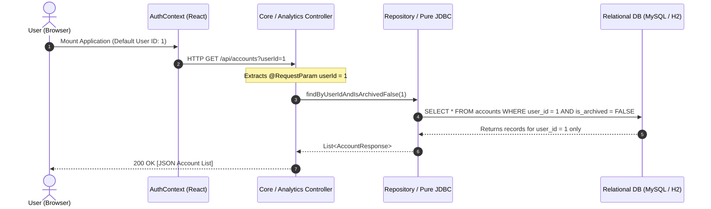

# 04. Roles & Authorization — FinPulse

## 1. Current-State Identification & User Scoping

### Technical Reality (What Actually Exists in the Codebase)
FinPulse does **NOT** currently employ an external identity provider, OAuth2/OIDC token broker, or Spring Security servlet filter chain (`spring-security-starter` is **NOT PRESENT** in `pom.xml`).

Instead, user identification and data isolation are implemented through **deterministic identifier scoping** at both the API layer and the relational database layer:

1. **Relational Data Isolation:**
   - Every core domain entity (`accounts`, `budgets`, `recurring_payments`, `savings_goals`) maintains an explicit foreign key column `user_id BIGINT NOT NULL` referencing the primary key `id` of the `users` table (`CONSTRAINT ... FOREIGN KEY (user_id) REFERENCES users(id) ON DELETE CASCADE`).
   - Transactions are scoped to accounts (`account_id BIGINT NOT NULL`), which in turn are scoped to users (`accounts.user_id = users.id`).
2. **Backend API Scoping Mechanism:**
   - In `finpulse-core-service`, every REST endpoint accepts `userId` either as a URL path variable (`/api/users/{id}`) or as an explicit query parameter (`@RequestParam(name = "userId", defaultValue = "1") Long userId`).
   - Every Spring Data repository derived method and custom JPQL query enforces tenant isolation via `WHERE a.userId = :userId` or `JOIN FETCH t.account a WHERE a.user.id = :userId`.
   - In `finpulse-analytics-service`, every analytical query in `SqlQueryCatalog.java` requires `userId` as the first bound parameter in `PreparedStatement.setLong(1, userId)`.
3. **Frontend Client Scoping (`AuthContext.jsx`):**
   - The React frontend encapsulates the active user session inside `src/context/AuthContext.jsx`.
   - State defaults to user `id: 1` (`Aarav Sharma`), persisted in browser `localStorage`.
   - When any page or hook fetches data, it reads `userId` from `AuthContext` and automatically appends it to outgoing REST queries (e.g., `/api/transactions?userId=1`, `/api/analytics/cashflow?userId=1`).

---

## 2. Real System Access Model (Single Active Role)

In the real codebase, exactly **ONE implicit role** exists across both microservices:
- **Role:** `ACCOUNT_OWNER` (Standard User)
- **Permissions:** Unrestricted CRUD access over their own records; zero cross-tenant visibility (User 1 cannot access or view User 2's accounts or transactions because repository queries strictly bind `user_id = ?`).

### Real Authorization Flow

---

## 3. Proposed INFERRED Role & Access Matrix (Future Production Architecture)

For an enterprise deployment integrating Spring Security 6 with JWT authentication, the following **INFERRED** Role-Based Access Control (RBAC) matrix represents the logical extension of the current domain model:

### Proposed Roles
1. **`ROLE_USER` (Standard Account Owner):** Individual managing personal finances. Full access to their own ledger; zero access to other users.
2. **`ROLE_AUDITOR` (Read-Only Financial Advisor / Tax Preparer):** Delegated view-only access for accountants, tax preparers, or family members. Can view ledger and export CSV, but cannot create or modify transactions.
3. **`ROLE_ADMIN` (System Administrator):** Operational role managing user lifecycle, database health checks, and global system configurations.

### Access Control Matrix

| Domain Feature / Endpoint | `ROLE_USER` (Owner) | `ROLE_AUDITOR` (Advisor) | `ROLE_ADMIN` (Operations) | Scope Enforcement Rule |
|:---|:---:|:---:|:---:|:---|
| **View Profile** (`GET /api/users/{id}`) | ✅ Permitted (Own ID) | ✅ Permitted (Scoped ID) | ✅ Permitted (Any ID) | `#id == authentication.principal.id` or `hasRole('ADMIN')` |
| **Update Profile** (`PUT /api/users/{id}`) | ✅ Permitted (Own ID) | ❌ Denied | ✅ Permitted | Owner only |
| **List & View Accounts** (`GET /api/accounts`) | ✅ Permitted (Own) | ✅ Permitted (Scoped) | ✅ Permitted (All) | Filtered by `user_id` |
| **Create / Edit Accounts** (`POST / PUT /api/accounts`) | ✅ Permitted (Own) | ❌ Denied | ❌ Denied | Mutating action restricted to Owner |
| **Archive / Delete Accounts** (`DELETE /api/accounts/{id}`) | ✅ Permitted (Own) | ❌ Denied | ✅ Permitted | Archive if transactions exist; hard delete if empty |
| **Log & Edit Transactions** (`POST / PUT /api/transactions`) | ✅ Permitted (Own) | ❌ Denied | ❌ Denied | Owner only; balance atomicity enforced |
| **View Transaction History** (`GET /api/transactions`) | ✅ Permitted (Own) | ✅ Permitted (Scoped) | ✅ Permitted (All) | Scoped to owned accounts |
| **Execute Transfer** (`POST /api/transfers`) | ✅ Permitted (Own) | ❌ Denied | ❌ Denied | Source and destination must belong to caller |
| **Manage Budgets** (`POST / PUT / DELETE /api/budgets`) | ✅ Permitted (Own) | ❌ Denied | ❌ Denied | Monthly budget limits set by Owner |
| **Manage Recurring Bills** (`POST / PUT / PATCH /api/recurring`) | ✅ Permitted (Own) | ❌ Denied | ❌ Denied | Owner only |
| **Trigger Recurring Payment** (`POST /api/recurring/{id}/pay`) | ✅ Permitted (Own) | ❌ Denied | ❌ Denied | Generates actual expense transaction |
| **Manage Savings Goals** (`POST / PUT / DELETE /api/goals`) | ✅ Permitted (Own) | ❌ Denied | ❌ Denied | Owner only |
| **View Analytical Reports** (`GET /api/analytics/*`) | ✅ Permitted (Own) | ✅ Permitted (Scoped) | ✅ Permitted (All) | High-performance read-only queries |
| **Export Transaction CSV** (`GET /api/analytics/export/transactions.csv`) | ✅ Permitted (Own) | ✅ Permitted (Scoped) | ✅ Permitted (All) | Streamed CSV with injection sanitization |
| **System Health Probe** (`GET /api/analytics/health`) | ✅ Permitted | ✅ Permitted | ✅ Permitted | Non-parameterized fixed Statement probe |
