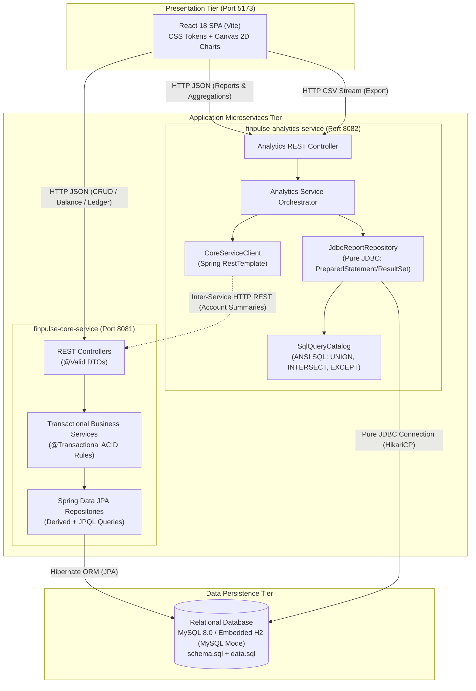
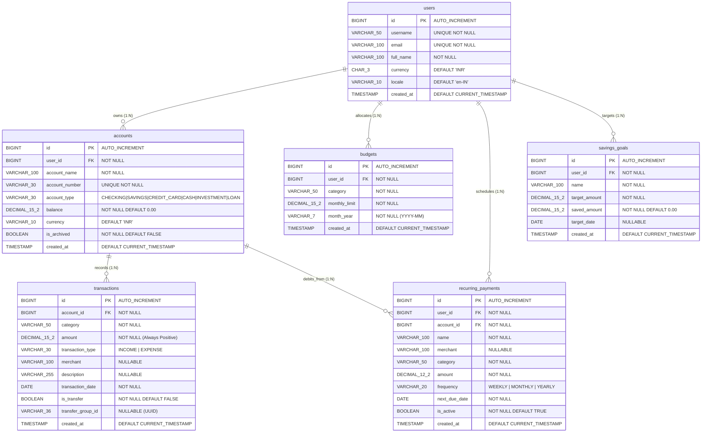

# 05. System Architecture & Technical Specifications — FinPulse

## 1. System Overview & Decomposition

FinPulse follows a decoupled microservices architecture designed to separate transactional write-intensive double-entry ledger operations from read-intensive, analytical SQL computations:



### Microservice Responsibilities & Ports
1. **Frontend Client (`finpulse-frontend` — Port `5173`):**
   - Single-page application providing responsive UI, theme toggling, form validations, and custom HTML5 Canvas 2D rendering.
2. **Core Microservice (`finpulse-core-service` — Port `8081`):**
   - Source of truth for all transactional entities. Enforces ACID guarantees, balance updates, transfer atomicity, overdraft guards, and JPA relational persistence.
3. **Analytics Microservice (`finpulse-analytics-service` — Port `8082`):**
   - Read-heavy analytical calculation engine. Bypasses ORM overhead using pure JDBC to execute complex relational set operations (`UNION`, `INTERSECT`, `EXCEPT`), rolling averages, and unbuffered CSV streaming.
4. **Inter-Service Communication:**
   - Analytics Service communicates with Core Service via `com.finpulse.analytics.client.CoreServiceClient` using Spring `RestTemplate` to fetch account summaries for executive dashboards.
5. **Cross-Origin Resource Sharing (CORS):**
   - Configured across both services to allow client origins `http://localhost:5173` (Vite dev server) and `http://localhost:3000` (production fallback) with standard HTTP methods (`GET`, `POST`, `PUT`, `PATCH`, `DELETE`, `OPTIONS`).

---

## 2. Layered Architecture & Component Inventory

### Core Microservice (`finpulse-core-service`)
```
src/main/java/com/finpulse/core/
├── controller/          # Presentation Layer (@RestController)
│   ├── AccountController.java
│   ├── TransactionController.java
│   ├── TransferController.java
│   ├── BudgetController.java
│   ├── RecurringPaymentController.java
│   ├── SavingsGoalController.java
│   ├── UserController.java
│   └── SummaryController.java
├── service/             # Business Logic Layer (@Service, @Transactional)
│   ├── AccountService.java
│   ├── TransactionService.java
│   ├── TransferService.java
│   ├── BudgetService.java
│   ├── RecurringPaymentService.java
│   ├── SavingsGoalService.java
│   ├── UserService.java
│   └── SummaryService.java
├── repository/          # Data Access Layer (Spring Data JpaRepository)
│   ├── AccountRepository.java
│   ├── TransactionRepository.java
│   ├── BudgetRepository.java
│   ├── RecurringPaymentRepository.java
│   ├── SavingsGoalRepository.java
│   └── UserRepository.java
├── model/               # Domain Entity Models (@Entity, @Table)
│   ├── User.java
│   ├── Account.java
│   ├── Transaction.java
│   ├── Budget.java
│   ├── RecurringPayment.java
│   └── SavingsGoal.java
├── dto/                 # Immutable Request/Response Records with @Valid
│   ├── AccountRequest.java, AccountResponse.java
│   ├── TransactionRequest.java, TransactionResponse.java
│   ├── TransferRequest.java, TransferResponse.java
│   ├── BudgetRequest.java, BudgetResponse.java, BudgetProgressResponse.java
│   ├── RecurringPaymentRequest.java, RecurringPaymentResponse.java
│   ├── SavingsGoalRequest.java, SavingsGoalResponse.java
│   ├── UserProfileRequest.java, UserProfileResponse.java
│   ├── SummaryOverviewResponse.java, ErrorResponse.java
│   └── ...
└── exception/           # Exception Handling (@RestControllerAdvice)
    ├── GlobalExceptionHandler.java
    ├── ResourceNotFoundException.java
    ├── BusinessConflictException.java
    └── InsufficientFundsException.java
```

### Analytics Microservice (`finpulse-analytics-service`)
```
src/main/java/com/finpulse/analytics/
├── controller/          # Analytics Endpoints
│   └── AnalyticsController.java
├── service/             # Analytical Logic & CSV Formatting
│   └── AnalyticsService.java
├── jdbc/                # Pure JDBC Data Layer
│   ├── JdbcReportRepository.java   # Connection, PreparedStatement, ResultSet
│   └── SqlQueryCatalog.java        # Central Raw ANSI SQL Catalog
├── client/              # Inter-Service REST Client
│   └── CoreServiceClient.java     # RestTemplate communicating with Port 8081
└── dto/                 # Analytical DTOs
    ├── CashflowPoint.java
    ├── CategoryBreakdownItem.java
    ├── SpendingSpikeItem.java
    ├── TimelineItem.java
    ├── RecurringMerchantItem.java
    ├── UnusedBudgetItem.java
    └── HealthStatus.java
```

---

## 3. Entity-Relationship (ER) Diagram



---

## 4. Data Exchange Contract

| Dataset | Producer | Consumer | Protocol | Mode / Frequency | Description |
|:---|:---|:---|:---|:---|:---|
| **Account Ledger** | Core (8081) | Frontend (5173) | HTTP REST | JSON on demand | Current balances, types, archival state |
| **Transaction Stream** | Core (8081) | Frontend (5173) | HTTP REST | JSON on demand (paginated/filtered) | Ledger records with merchant, category, date |
| **Account Summary** | Core (8081) | Analytics (8082) | HTTP REST | JSON on demand | `CoreServiceClient` retrieves balances for executive rollup |
| **Cashflow Aggregations** | Analytics (8082) | Frontend (5173) | HTTP REST | JSON on demand | 6-month monthly income, expense, and net values |
| **Category Distribution** | Analytics (8082) | Frontend (5173) | HTTP REST | JSON on demand | Spend per category and percentage share |
| **Spending Spikes** | Analytics (8082) | Frontend (5173) | HTTP REST | JSON on demand | Categories exceeding 120% of 3-month baseline |
| **Timeline Projection** | Analytics (8082) | Frontend (5173) | HTTP REST | JSON on demand | Chronological SQL `UNION` of actuals and bills |
| **Recurring Vendors** | Analytics (8082) | Frontend (5173) | HTTP REST | JSON on demand | SQL `INTERSECT` repeat vendor audit |
| **Unused Budgets** | Analytics (8082) | Frontend (5173) | HTTP REST | JSON on demand | SQL `EXCEPT` zero-burn budget health |
| **CSV Transaction Stream** | Analytics (8082) | Frontend (5173) | HTTP Stream | RFC 4180 CSV Cursor Stream | Unbuffered JDBC cursor stream with formula injection guards |

---

## 5. Complete API Reference Tables

### Core Service (`finpulse-core-service` — Port 8081)

| HTTP Method | Path | Query / Path Parameters | Request Body (DTO) | Response Body Shape | Status Codes |
|:---|:---|:---|:---|:---|:---|
| `GET` | `/api/users/{id}` | `id` (path) | None | `UserProfileResponse` | 200, 404 |
| `PUT` | `/api/users/{id}` | `id` (path) | `UserProfileRequest` (@Valid) | `UserProfileResponse` | 200, 400, 404 |
| `GET` | `/api/accounts` | `userId` (opt) | None | `List<AccountResponse>` | 200 |
| `GET` | `/api/accounts/{id}` | `id` (path, regex `\d+`) | None | `AccountResponse` | 200, 404 |
| `POST` | `/api/accounts` | None | `AccountRequest` (@Valid) | `AccountResponse` | 201, 400 |
| `PUT` | `/api/accounts/{id}` | `id` (path) | `AccountRequest` (@Valid) | `AccountResponse` | 200, 400, 404 |
| `DELETE` | `/api/accounts/{id}` | `id` (path) | None | `AccountDeleteResponse` | 200, 404 |
| `GET` | `/api/accounts/summary` | `userId` (opt) | None | `AccountSummaryListResponse` | 200 |
| `GET` | `/api/accounts/net-worth`| `userId` (opt) | None | `NetWorthResponse` | 200 |
| `GET` | `/api/transactions` | `userId`, `accountId`, `category`, `type`, `search`, `from`, `to`, `limit`, `offset` | None | `List<TransactionResponse>` | 200 |
| `GET` | `/api/transactions/{id}`| `id` (path) | None | `TransactionResponse` | 200, 404 |
| `POST` | `/api/transactions` | None | `TransactionRequest` (@Valid) | `TransactionResponse` | 201, 400 |
| `PUT` | `/api/transactions/{id}`| `id` (path) | `TransactionRequest` (@Valid) | `TransactionResponse` | 200, 400, 404 |
| `DELETE` | `/api/transactions/{id}`| `id` (path) | None | `void` | 204, 404 |
| `POST` | `/api/transfers` | None | `TransferRequest` (@Valid) | `TransferResponse` | 201, 400, 404 |
| `GET` | `/api/budgets` | `userId`, `month` | None | `List<BudgetResponse>` | 200 |
| `GET` | `/api/budgets/progress` | `userId`, `month` | None | `List<BudgetProgressResponse>` | 200 |
| `POST` | `/api/budgets` | None | `BudgetRequest` (@Valid) | `BudgetResponse` | 200, 400 |
| `PUT` | `/api/budgets/{id}` | `id` (path) | `BudgetRequest` (@Valid) | `BudgetResponse` | 200, 400, 404 |
| `DELETE` | `/api/budgets/{id}` | `id` (path) | None | `void` | 204, 404 |
| `POST` | `/api/budgets/copy` | None | `BudgetCopyRequest` | `List<BudgetResponse>` | 200, 400 |
| `GET` | `/api/recurring` | `userId` (opt) | None | `List<RecurringPaymentResponse>` | 200 |
| `POST` | `/api/recurring` | None | `RecurringPaymentRequest` (@Valid) | `RecurringPaymentResponse` | 201, 400 |
| `PUT` | `/api/recurring/{id}` | `id` (path) | `RecurringPaymentRequest` (@Valid) | `RecurringPaymentResponse` | 200, 400, 404 |
| `PATCH` | `/api/recurring/{id}/active` | `id` (path), `active` (query) | None | `RecurringPaymentResponse` | 200, 404 |
| `POST` | `/api/recurring/{id}/pay` | `id` (path) | None | `TransactionResponse` | 200, 404, 409 |
| `DELETE` | `/api/recurring/{id}` | `id` (path) | None | `void` | 204, 404 |
| `GET` | `/api/goals` | `userId` (opt) | None | `List<SavingsGoalResponse>` | 200 |
| `POST` | `/api/goals` | None | `SavingsGoalRequest` (@Valid) | `SavingsGoalResponse` | 201, 400 |
| `PUT` | `/api/goals/{id}` | `id` (path) | `SavingsGoalRequest` (@Valid) | `SavingsGoalResponse` | 200, 400, 404 |
| `DELETE` | `/api/goals/{id}` | `id` (path) | None | `void` | 204, 404 |
| `GET` | `/api/summary/overview`| `userId` (opt), `month` (opt) | None | `SummaryOverviewResponse` | 200 |

### Analytics Service (`finpulse-analytics-service` — Port 8082)

| HTTP Method | Path | Query / Path Parameters | Request Body | Response Body Shape | Status Codes |
|:---|:---|:---|:---|:---|:---|
| `GET` | `/api/analytics/health` | None | None | `HealthStatus` (`{status: "UP", database: "CONNECTED"}`) | 200 |
| `GET` | `/api/analytics/cashflow` | `userId`, `months` (def: 6) | None | `List<CashflowPoint>` | 200 |
| `GET` | `/api/analytics/category-breakdown` | `userId`, `month` (YYYY-MM) | None | `List<CategoryBreakdownItem>` | 200 |
| `GET` | `/api/analytics/spending-spikes` | `userId`, `month` (YYYY-MM) | None | `List<SpendingSpikeItem>` | 200 |
| `GET` | `/api/analytics/timeline` | `userId`, `days` (def: 30) | None | `List<TimelineItem>` | 200 |
| `GET` | `/api/analytics/recurring-merchants` | `userId`, `month` (YYYY-MM) | None | `List<RecurringMerchantItem>` | 200 |
| `GET` | `/api/analytics/unused-budgets` | `userId`, `month` (YYYY-MM) | None | `List<UnusedBudgetItem>` | 200 |
| `GET` | `/api/analytics/account-balances` | `userId` | None | `List<AccountBalanceItem>` | 200 |
| `GET` | `/api/analytics/export/transactions.csv` | `userId`, `from`, `to` | None | Streamed RFC 4180 CSV | 200 |
| `GET` | `/api/analytics/overview` | `userId`, `month` | None | `AnalyticsOverviewResponse` | 200 |
| `GET` | `/api/analytics/user/{userId}/executive-dashboard` | `userId` (path) | None | `ExecutiveDashboardResponse` | 200 |

---

## 6. Business Rules Enforced

1. **Balance Atomicity on Transactions:**
   - *Rule:* Logging an expense decreases account balance; logging income increases balance. Deleting or editing a transaction applies the exact balance differential.
   - *Enforced By:* `com.finpulse.core.service.TransactionService` (`createTransaction`, `updateTransaction`, `deleteTransaction`) inside `@Transactional`.
2. **Transfer Pairing & Isolation:**
   - *Rule:* Transfers must atomically create two linked records (`EXPENSE` on source, `INCOME` on destination) with `is_transfer = TRUE` and shared UUID `transfer_group_id`. Transfers are strictly excluded from all income/expense analytics.
   - *Enforced By:* `com.finpulse.core.service.TransferService` (`executeTransfer`).
3. **Checking Overdraft Prevention:**
   - *Rule:* Transfers and expense transactions from CHECKING or CASH accounts cannot drive balance below zero.
   - *Enforced By:* `com.finpulse.core.service.TransferService` and `TransactionService` throwing `BusinessConflictException` (HTTP 409) or `InsufficientFundsException` (HTTP 400).
4. **Account Archival vs. Deletion:**
   - *Rule:* Accounts with transaction history cannot be hard deleted; they are archived (`is_archived = TRUE`) to preserve financial audit integrity. Accounts with zero transactions are hard deleted.
   - *Enforced By:* `com.finpulse.core.service.AccountService` (`deleteAccount`).
5. **Recurring Due Date Advancement:**
   - *Rule:* When an active recurring bill is marked paid, an expense transaction is automatically recorded and `next_due_date` advances forward according to frequency (`WEEKLY` + 7 days, `MONTHLY` + 1 month, `YEARLY` + 1 year). Inactive commitments cannot be paid.
   - *Enforced By:* `com.finpulse.core.service.RecurringPaymentService` (`recordPayment`).
6. **Savings Goal Amortization:**
   - *Rule:* Required monthly deposit is dynamically amortized across remaining calendar months: $\text{Required} = \frac{\text{Target} - \text{Saved}}{\text{Months Remaining}}$. Target date in the past requires the entire balance immediately.
   - *Enforced By:* `com.finpulse.core.service.SavingsGoalService` (`toResponse`).
7. **Budget Unique Constraint & Threshold Warnings:**
   - *Rule:* Exactly one budget can exist per `(user_id, category, month_year)`. Spending $\ge 80\%$ triggers WARNING; spending $> 100\%$ triggers OVER.
   - *Enforced By:* Database constraint `uq_budgets_user_cat_month` and `com.finpulse.core.service.BudgetService` (`getBudgetProgress`).

---

## 7. Security, Validation & Config Management

- **Bean Validation:** Incoming REST records validated via Jakarta annotations (`@NotNull`, `@NotBlank`, `@DecimalMin("0.01")`, `@Pattern`).
- **Parameterized SQL:** All JDBC calls bind parameters via `PreparedStatement` index placeholders (`?`), preventing SQL injection.
- **CSV Injection Defense:** When streaming CSVs, any field starting with formula triggers (`=`, `+`, `-`, `@`) is prepended with a tab character (`\t`) to prevent DDE/code execution in Excel.
- **Structured Error Responses:** All uncaught exceptions return uniform `ErrorResponse` records (`timestamp`, `status`, `error`, `message`, `fieldErrors`).
- **Profiles & Config:**
  - `default`: Embedded H2 file database (`jdbc:h2:file:./database/finpulsedb;MODE=MySQL;DATABASE_TO_LOWER=TRUE`).
  - `mysql`: Production profile (`jdbc:mysql://localhost:3306/finpulse`).
  - Environment variables supported: `SPRING_PROFILES_ACTIVE`, `SPRING_DATASOURCE_URL`, `SPRING_DATASOURCE_USERNAME`, `SPRING_DATASOURCE_PASSWORD`.
