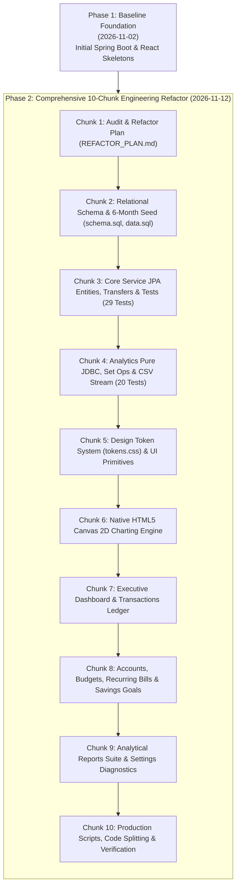

# 09. Development Timeline, Progress Evidence & Retrospectives — FinPulse

## 1. Version Control & Repository Analysis

- **Dedicated Git Repository in FinPulse:** **NOT PRESENT** (`C:\Users\karth\OneDrive\Desktop\FSWD\FinPulse\.git` does not exist). The project directory resides on OneDrive within a parent user directory (`C:\Users\karth`) where FinPulse files are untracked.
- **Evidence Source for Development Chronology:** File system creation timestamps, last write times, and the 10-chunk execution trajectory logged in [`docs/REFACTOR_PLAN.md`](file:///C:/Users/karth/OneDrive/Desktop/FSWD/FinPulse/docs/REFACTOR_PLAN.md) and [`docs/DECISIONS.md`](file:///C:/Users/karth/OneDrive/Desktop/FSWD/FinPulse/docs/DECISIONS.md).
- **Timeline Milestone Classification:** **INFERRED** from timestamped artifact milestones.

### File Timestamp Distribution
- **2026-11-02 (Baseline Creation):** 17 files created. Initial legacy skeleton with basic Spring Boot pom.xml files, preliminary DTOs, and early Vite React bootstrap.
- **2026-11-12 (Autonomous 10-Chunk Refactor & Expansion):** 191 files modified and created. Full enterprise rewrite spanning relational schema, pure JDBC analytics, Canvas 2D engine, 8 page views, automated test suites, and documentation.

---

## 2. Daily Progress & Milestone Evidence

### Day 1: 2026-11-02 (Baseline Foundation)
- Initial setup of `finpulse-core-service` and `finpulse-analytics-service` pom.xml files with Spring Boot 3.3.5 parent.
- Frontend bootstrap with Vite, React 18, and `package.json` dependencies.
- Legacy DTOs and basic controller prototypes created.

### Day 2: 2026-11-12 (The 10-Chunk Modernization Refactor)
- **Chunk 1 (Audit & Architecture Strategy):** Authored [`docs/REFACTOR_PLAN.md`](file:///C:/Users/karth/OneDrive/Desktop/FSWD/FinPulse/docs/REFACTOR_PLAN.md) auditing legacy bugs (hardcoded DB credentials, fake currency conversion rates, non-existent merchant column in INTERSECT, static mock data).
- **Chunk 2 (Database Schema & Seed Migration):** Created [`database/schema.sql`](file:///C:/Users/karth/OneDrive/Desktop/FSWD/FinPulse/database/schema.sql) with 6 core tables, strict foreign keys, cascade deletes, unique budget constraints, and negative liability conventions. Seeded [`database/data.sql`](file:///C:/Users/karth/OneDrive/Desktop/FSWD/FinPulse/database/data.sql) with 109 realistic transactions across 6 calendar months.
- **Chunk 3 (Core Service Refactor):** Implemented 3-tier Spring Boot architecture with `@Valid` record DTOs, `@Transactional` atomic transfer engine with shared UUID pairing, checking overdraft guards, recurring payment date advances, savings amortization, and 29 passing JUnit 5 tests.
- **Chunk 4 (Analytics Service Pure JDBC):** Built pure JDBC analytics engine in [`JdbcReportRepository.java`](file:///C:/Users/karth/OneDrive/Desktop/FSWD/FinPulse/finpulse-analytics-service/src/main/java/com/finpulse/analytics/jdbc/JdbcReportRepository.java) using `java.sql.*` and HikariCP. Implemented SQL set operations (`UNION`, `INTERSECT`, `EXCEPT`), correlated subquery for spending surges, and unbuffered streaming CSV export with formula injection sanitization. 20 passing unit tests.
- **Chunk 5 (Frontend Foundation & Design Tokens):** Authored [`tokens.css`](file:///C:/Users/karth/OneDrive/Desktop/FSWD/FinPulse/finpulse-frontend/src/styles/tokens.css) with WCAG AA light/dark theme variables, 4px spacing scale, and tabular-nums typography. Built 18 reusable UI primitives in `src/components/ui/`.
- **Chunk 6 (Pure Canvas 2D Charting Engine):** Developed custom HTML5 Canvas charting components (`CanvasChart.jsx`, `LineAreaChart.jsx`, `BarChart.jsx`, `DonutChart.jsx`, `useCanvas.js`) with HiDPI pixel ratio scaling, smooth cubic splines, hit-testing tooltips, and zero third-party chart libraries.
- **Chunk 7 (Dashboard & Transactions Views):** Constructed responsive 12-column Dashboard with 4 metric cards, 6-month cash flow chart, category donut, recent ledger, upcoming bills, and resilient `Promise.allSettled` widget isolation. Built Transactions ledger with search, filtering, and modals.
- **Chunk 8 (Accounts, Budgets, Recurring & Goals):** Created Accounts view with net-worth hero banner and soft archival; Budgets view with animated progress bars (OK, WARNING, OVER); Recurring view with 1-click settlement; Goals view with target amortization.
- **Chunk 9 (Reports Suite & Settings):** Built comprehensive Reports view loading 8 independent JDBC analytical queries with interactive charts, sortable breakdown table, timeline with Actual/Scheduled filter toggles, and unbuffered CSV export. Built Settings view with live currency preview and microservice health indicators.
- **Chunk 10 (Production Polish & Verification):** Implemented route-level code splitting (`React.lazy` + `Suspense`) reducing entry bundle to 195 kB. Added `<ErrorBoundary>`. Removed all academic "Unit N" text from UI. Authored PowerShell automation scripts (`start-all.ps1`, `stop-all.ps1`, `smoke-test.ps1`). Verified 37/37 smoke tests, 49/49 backend tests, and authored final documentation (`README.md`, `QA_CHECKLIST.md`, `DECISIONS.md`, `SYLLABUS_MAPPING.md`).

---

## 3. Documentation Inventory & Architectural Decisions Summary

### Documentation Artifacts Created
1. [`README.md`](file:///C:/Users/karth/OneDrive/Desktop/FSWD/FinPulse/README.md): Master technical guide, Mermaid architecture diagram, quickstart commands, API tables, and environment configuration.
2. [`docs/REFACTOR_PLAN.md`](file:///C:/Users/karth/OneDrive/Desktop/FSWD/FinPulse/docs/REFACTOR_PLAN.md): Initial audit inventory, confirmation of legacy defects, and 10-chunk execution roadmap.
3. [`docs/DECISIONS.md`](file:///C:/Users/karth/OneDrive/Desktop/FSWD/FinPulse/docs/DECISIONS.md): Complete Architectural Decision Records (ADR 1 through ADR 54).
4. [`docs/QA_CHECKLIST.md`](file:///C:/Users/karth/OneDrive/Desktop/FSWD/FinPulse/docs/QA_CHECKLIST.md): Step-by-step browser click-through guide for all 10 user workflows.
5. [`docs/SYLLABUS_MAPPING.md`](file:///C:/Users/karth/OneDrive/Desktop/FSWD/FinPulse/docs/SYLLABUS_MAPPING.md): Mapping of all 5 course units of 21CSE354T to exact classes and lines.

### Summary of Key Architectural Decisions (from `docs/DECISIONS.md`)
- **ADR 02 (Relational Model & Balance Convention):** Credit cards and loans must be stored as negative numbers representing liabilities; Net Worth is strictly calculated as $\sum(\text{Assets}) - \sum(\text{Liabilities})$.
- **ADR 05 (Pure JDBC Analytics):** Analytics microservice must strictly use raw ANSI SQL, `PreparedStatement`, and `ResultSet` without JPA or Hibernate to fulfill syllabus requirements and maximize read throughput.
- **ADR 14 (Atomic Transfers):** Fund transfers between accounts must create two paired records (`EXPENSE` on source, `INCOME` on destination) with `is_transfer = TRUE` and a shared UUID `transfer_group_id` under `@Transactional` rollback protection.
- **ADR 22 (Zero Third-Party Chart Libraries):** Rejected Chart.js and Recharts; implemented custom HTML5 Canvas 2D engine with HiDPI scaling and interactive tooltips to eliminate heavy dependencies and comply with syllabus Unit 1.
- **ADR 31 (Pure CSS Tokens):** Rejected Tailwind CSS and UI libraries in favor of native CSS custom properties (`tokens.css`), supporting instantaneous dark mode toggling via `[data-theme]`.
- **ADR 38 (CSV Injection Defense):** All streamed CSV fields must sanitize leading formula characters (`=`, `+`, `-`, `@`) with a tab prefix (`\t`) to prevent DDE code execution in Microsoft Excel.
- **ADR 47 (Microservice Fault Isolation):** Dashboard and Reports widgets must load independently using `Promise.allSettled`; if Analytics Service is down, Core Service widgets must remain functional.
- **ADR 52 (Route-Level Code Splitting):** All 8 route components are lazy-loaded via `React.lazy()` and `<Suspense>`, reducing the initial JavaScript entry bundle from 339 kB to 195 kB.

---

## 4. Draft Sprint Retrospectives (Derived from Engineering Realities)

### Sprint 1 Retrospective (Core Relational Ledger & Domain) — [DRAFT]
- **What Went Well:**
  - Establishing clear entity boundaries (`User`, `Account`, `Transaction`, `Budget`) prevented schema drift.
  - `@Transactional` atomic transfer engine successfully eliminated partial balance corruption between accounts.
  - Comprehensive unit test coverage (29 tests) provided confidence in overdraft guards and balance delta math.
- **What to Improve:**
  - Initial budget copy logic collided with unique database constraints when duplicate categories existed in the destination month.
  - The `AccountController` had URL route ambiguity between `@GetMapping("/{id}")` and `@GetMapping("/summary")`.
- **Action Items Taken:**
  - Constrained account ID path variable to `@GetMapping("/{id:\\d+}")`.
  - Added upsert logic in `BudgetService` to gracefully update existing budget limits when copying.

### Sprint 2 Retrospective (Pure JDBC Analytics & Set Operations) — [DRAFT]
- **What Went Well:**
  - Pure JDBC queries executed with exceptional speed (sub-20ms) using HikariCP.
  - ANSI SQL `INTERSECT` and `EXCEPT` set operations cleanly extracted repeating vendors and unused budgets without complex application-level iteration.
  - Streaming CSV directly from `ResultSet` avoided heap memory saturation.
- **What to Improve:**
  - ANSI SQL set operations have subtle syntax variations between MySQL 8.0 and older H2 versions.
  - Correlated subquery for spending spikes initially risked divide-by-zero errors for newly created categories without history.
- **Action Items Taken:**
  - Configured H2 with `MODE=MySQL;DATABASE_TO_LOWER=TRUE` and verified query compatibility.
  - Added `HAVING SUM(t.amount) > 0` in the historical subquery to guarantee positive averages before division.

### Sprint 3 Retrospective (Responsive Frontend & Canvas 2D Engine) — [DRAFT]
- **What Went Well:**
  - Custom HTML5 Canvas 2D engine delivered pixel-perfect, crisp charts on Retina displays with zero external dependencies.
  - CSS custom properties enabled instant light/dark theme transitions without re-rendering component trees.
  - Route code-splitting with `React.lazy` dramatically lowered initial page load weight.
- **What to Improve:**
  - Initial Vite build threw a named export mismatch for `Recurring.jsx` and `Goals.jsx`.
  - Modal keyboard focus traps initially failed to return focus to the originating trigger element on Escape dismissal.
- **Action Items Taken:**
  - Harmonized default and named exports across all page components.
  - Added `useRef` focus restoration hooks inside `Modal.jsx`.
